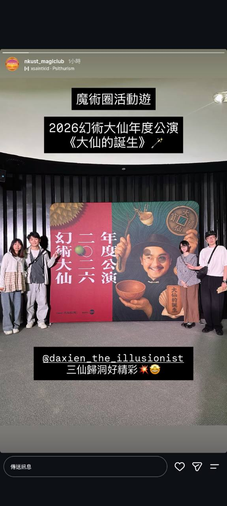

# About Us
## NKUST MAGIC CLUB

---

## Our Mission

Guided by mutual support and a spirit of contribution, we share sound magic theory, performance skills and a passion for magic with our members. We encourage members to take part in magic conventions, workshops and competitions, building new experiences and achievements together.

---

## Our Story

Magic is a performing art that uses skill and knowledge to create laughter, wonder and seemingly impossible experiences. Following the university merger, our club has continued to uphold sound principles of magic and build on its competition achievements, growing into one of southern Taiwan's most influential university magic clubs.

Founded in 2005, the club has nurtured members who have won competitions and been invited to perform as guests. Our major events have also welcomed international guest performers from Japan, Hong Kong, Malaysia and South Korea.

---

## Advisors & Officers

- [Meet Our Advisors & Officers](team.html)

---

## Six Ways to Experience Magic

### Club Classes

- [See Our Club Classes on Instagram](https://www.instagram.com/p/DYQqXmCk5BO)

### Welcome Gathering

- [See Our Welcome Gathering on Instagram](https://www.instagram.com/p/DVgDcDokdmF)

### Street Magic

- [See Our Street Magic on Instagram](https://www.instagram.com/p/DROTPrUkduB)

### Stage Magic Shows

- [See Our Stage Magic Shows on Instagram](https://www.instagram.com/tv/CkS6QW0tYpQ)

### Intercollegiate Magic Exchanges

- [See Our Intercollegiate Exchanges on Instagram](https://www.instagram.com/p/DYa5IBzk8mm)

### Exploring the Magic Community

