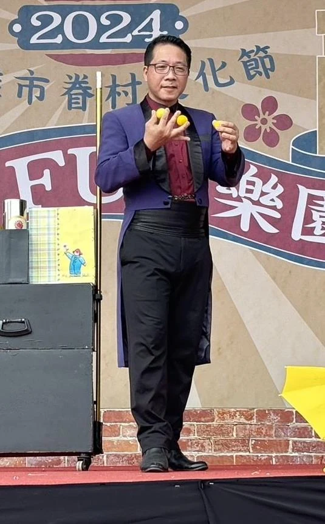
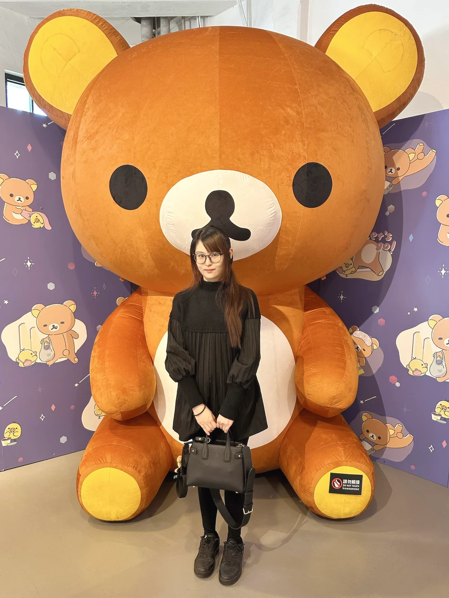
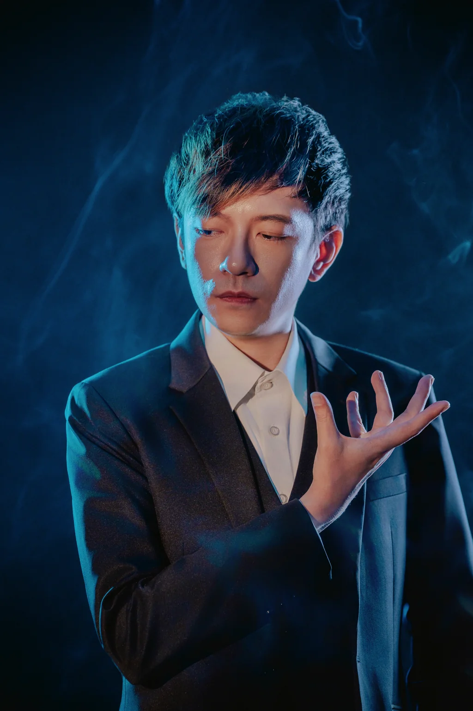
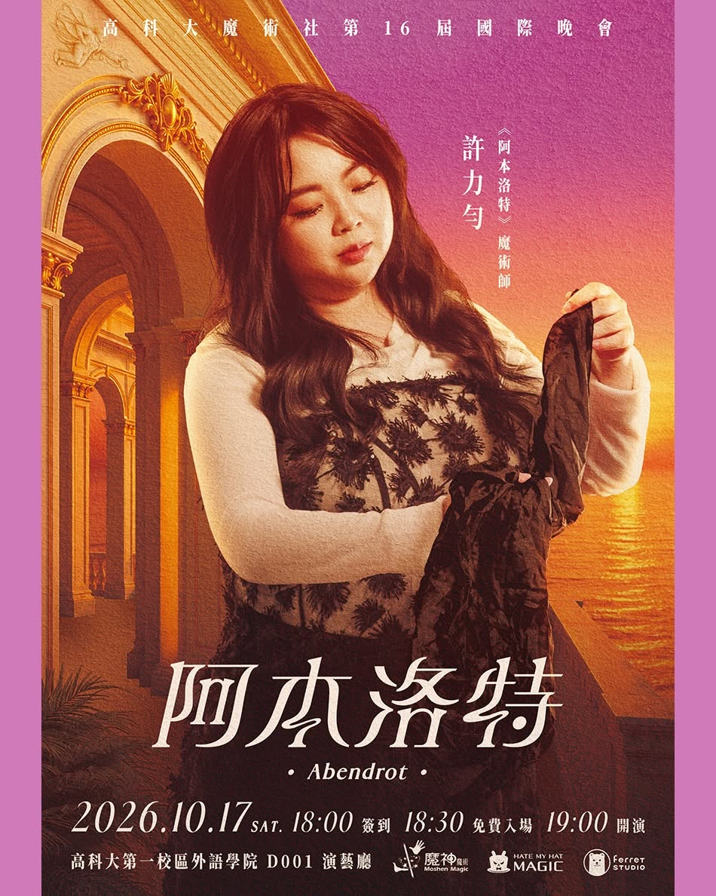

# Advisors & Officers
## NKUST MAGIC CLUB

---

## Instructor | Chen Bing-rong (陳炳榮)

A professional magician and former president of the Kaohsiung Magic Association, Chen has long been involved in magic performance, teaching and outreach. He has advised school magic clubs at National Kaohsiung University of Science and Technology, Pingtung University of Education, the Air Force Academy, Kaohsiung Industrial High School and Wufu Junior High School.

He helped promote a two-minute stage magic exchange competition, giving newcomers opportunities to perform, gain experience and learn from one another. He has also combined magic with school drug-prevention campaigns, bringing magic into a wider range of learning and everyday settings.

---

## Administrative Advisor | MT Yang (孟婷)

A graphic designer at Ferret Studio, MT Yang creates magic show posters, event visual identities, books and playing cards. She has long contributed to NKUST Magic Club's visual design and event planning, serving as the main visual designer for the club's 8th through 16th annual showcases and helping plan the RE-ACT series organized by the club.

Her work includes cover designs for The Magician's Magic (《魔術師的魔術》) book series and illustrations for its second volume. She has also contributed to Korean magician Lukas's A Trip To The Moon poster, the main visual for the OMG Magic Convention's 《金牌魔術腦》, and Lai Po-cheng's FANtast playing cards.

---

## Magic Advisor | Chen Che-da (陳徹達)

The founder of Hate My Hat Magic, Chen has long worked in magic teaching, performance and publishing. He placed second in the 2022 TMA × Unicorn Supernova talent competition. A former instructor of NKUST Magic Club, he has also helped organize the club's showcases, RE-ACT Magic Exchange and RE-ACT SHOW.

He published The Magician's Magic (《魔術師的魔術》) book series and wrote annotations for its second volume, 《魔術師的魔術：談魔術實作》. The series features a foreword and recommendation by internationally renowned magician Lu Chen (劉謙).

---

## President | Lu Jing-xun (盧敬勳)

Department of Mechatronics Engineering

---

## Vice President | Hsu Li-yun (許力勻)

Department of Information Management

